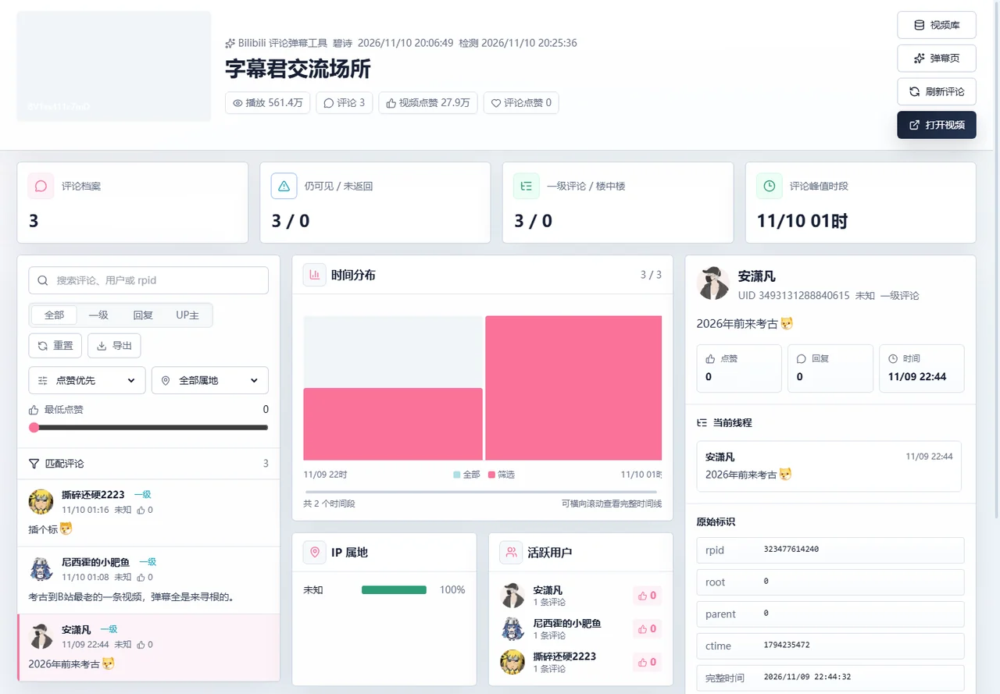
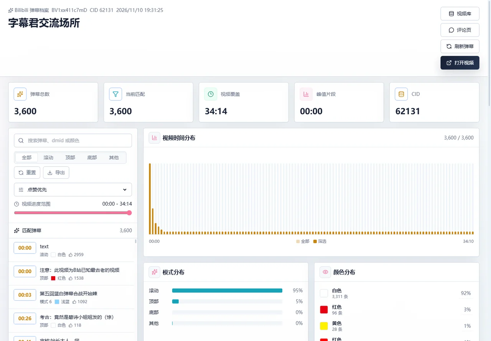
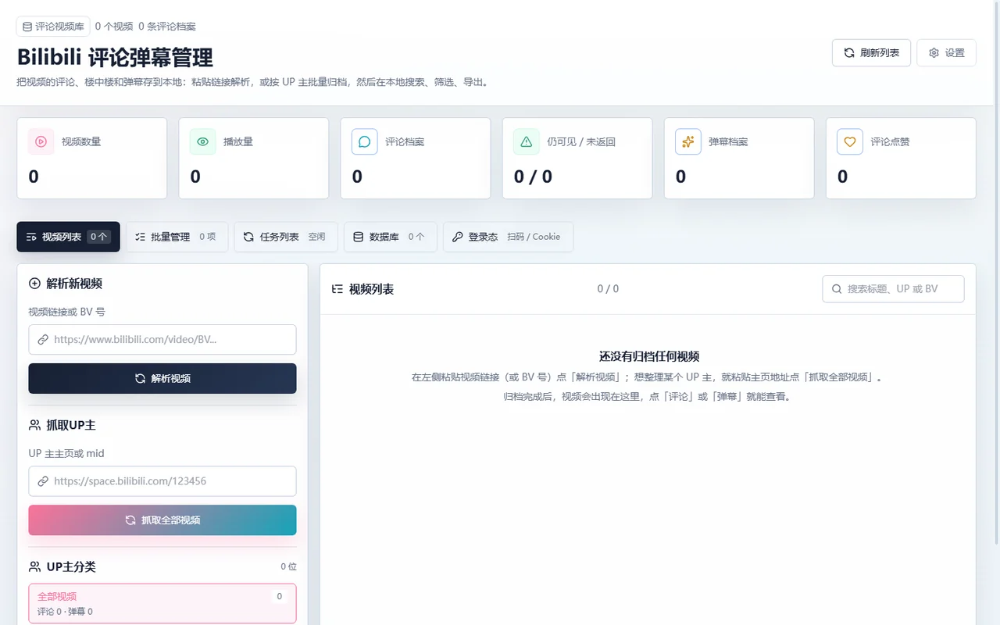

# bilibili-comment-danmaku-tool

把 Bilibili 视频的**评论、楼中楼、弹幕**存到本地，随时搜索、筛选、导出。纯本地运行，不依赖任何在线服务。


## 能做什么

- **归档单个视频**：粘贴链接或 BV 号，抓评论、楼中楼、弹幕，存成 `data/databases/<UP主>/<BVID>.db`。
- **按 UP 主批量归档**：粘贴 UP 主主页抓全部视频；任务可以暂停、恢复、停止，排队状态随时可见。
- **本地浏览**：评论按时间/点赞/回复排序，按一级/回复/UP主/属地/最低点赞筛选，搜正文、用户、rpid；弹幕看视频时间轴分布、模式/颜色统计、重复弹幕。
- **导出**：评论/弹幕导出 CSV；单个视频或整个 UP 主导出 SQLite / JSON；导出的库还能再导入。
- **多库管理**：一个视频一个库，列表里能看到视频数、评论数、占用空间、可回收空间。
- **登录**：扫码或粘贴 Cookie。匿名模式站方只返回极少量评论，要看全量必须登录。

## 截图

### 评论页：搜索、筛选、单条详情、楼中楼



### 弹幕页：时间分布、模式/颜色统计、重复弹幕



## 第一次使用

1. 启动工具，浏览器打开 `http://127.0.0.1:8001/`。
2. 左侧「解析新视频」粘贴 `https://www.bilibili.com/video/BVxxxx` 或 `BVxxxx`，点「解析视频」。
3. 顶部切到「任务列表」看抓取进度；完成后回「视频列表」。
4. 点视频右侧「评论」或「弹幕」查看、筛选、导出。
5. 想抓整个 UP 主：左侧「抓取UP主」粘贴 `https://space.bilibili.com/123456`，点「抓取全部视频」。

空库时长这样，右侧会直接告诉你下一步做什么：



> 匿名只能拿到 3 条左右的评论，这是 B 站接口限制，不是工具 bug。需要全量就在「登录态」里扫码或粘贴 Cookie 后重新抓取。

## 启动

### 打包好的 exe（Windows，推荐）

从 [Releases](https://github.com/sanxiadaba/bilibili-comment-danmaku-tool/releases) 下载 zip，解压双击 `bilibili-comment-danmaku-tool.exe`。它会启动本地服务、弹出状态窗口并打开浏览器。数据在 exe 旁边的 `data/`，日志在 `logs/`；换电脑时一起拷走即可。

### 从源码

```powershell
pnpm install
pnpm build        # 编码检查 + 测试 + TypeScript 检查 + Vite 构建
pnpm server       # http://127.0.0.1:8001/
```

改前端时开两个终端，`pnpm dev` 会热更新并把 `/api` 代理到后端：

```powershell
pnpm server
pnpm dev
```

端口默认 8001，被占用会自动顺延；真实端口写在 `data/.server-port`，`pnpm dev` 会读它。

## 页面说明

| 页面 | 用途 |
| --- | --- |
| 视频列表 | 左侧解析视频、抓取 UP 主、按 UP 主筛选；右侧视频卡片；顶部是当前库的汇总统计 |
| 批量管理 | 按视频或 UP 主多选，批量删除 / 导出 SQLite / 导出 JSON |
| 任务列表 | 排队、暂停、恢复、停止、重试、清空任务记录 |
| 数据库 | 查看所有库、占用空间和可回收空间；导入 `.db/.sqlite/.json` |
| 登录态 | 扫码登录或手动粘贴 Cookie，显示登录是否有效 |

评论页和弹幕页都支持搜索、筛选、排序、导出 CSV；评论页右侧是当前选中评论的详情和它的楼中楼。

## 数据在哪

- 一视频一库：`data/databases/<UP主>/<BVID>.db`
- 页面里的 `main` 是「全部视频」聚合视图，不是物理数据库
- 旧版单库 `data/comment_danmaku.db` 启动时会自动迁移并改名备份
- Cookie：`data/cookie.txt`（可选）
- 日志：`logs/app.jsonl`（Cookie 等敏感字段已脱敏）

## 命令行

```powershell
python backend/app_cli.py fetch-video BV1xx411c7mD
python backend/app_cli.py list-space https://space.bilibili.com/1538787344 --max-videos 3
python backend/app_cli.py archive-space https://space.bilibili.com/1538787344 --max-videos 1
```

打包后的 exe 用 `bilibili-comment-danmaku-tool.exe cli fetch-video BV1xx411c7mD`。

常用参数：`--cookie "SESSDATA=..."`、`--delay`、`--comment-pages N`、`--skip-children`、`--skip-danmaku`、`--skip-danmaku-likes`、`--force`。

## 数据安全规则

- 刷新评论时，远端返回数量不到本地的一半就**拒绝覆盖**，保留原档案；确认要覆盖时带 `force=1`（CLI 加 `--force`）。
- 远端返回 0 条弹幕时，保留本地已有弹幕。
- 删除是后台任务，先删评论/弹幕再删视频行，中断后可以重试。
- 匿名或限流造成的「少量结果」不会把库清空。

## 常见问题

**为什么只抓到 3 条评论？** 匿名接口限制，登录后重抓。

**刷新会把旧评论删掉吗？** 不会物理删除，本次没返回的标记为「未返回」，仍然可见；数量异常时整体拒绝覆盖。

**8001 被占用怎么办？** 会自动顺延端口，状态窗口和日志里显示的就是真实地址。

**exe 双击没反应？** 看 exe 旁边 `logs/app.jsonl` 的最后几行，常见原因是被杀软拦截或数据目录无写权限。

**想备份 / 换电脑？** 拷整个 `data/`，或把库导出成 SQLite/JSON 再导入。

## 开发

代码结构、请求流程、数据表、任务队列、改哪里看哪里，见 [`docs/architecture.md`](docs/architecture.md)。测试与提交规则见 `AGENTS.md`。

## 发布

打 tag 触发构建和发布：

```powershell
git tag v1.0.3
git push origin v1.0.3
```

也可以在 GitHub Actions 里手动运行 `Release`。
